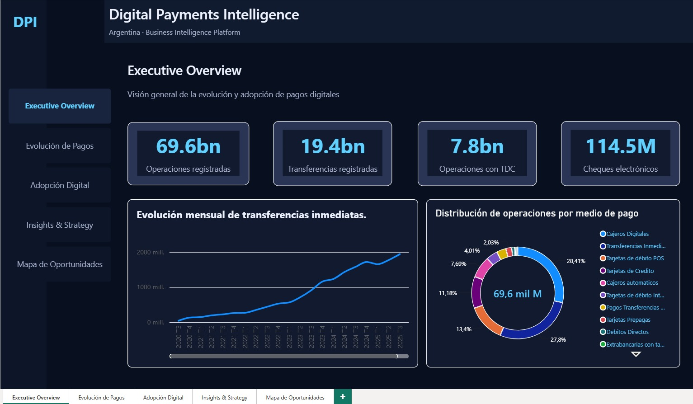
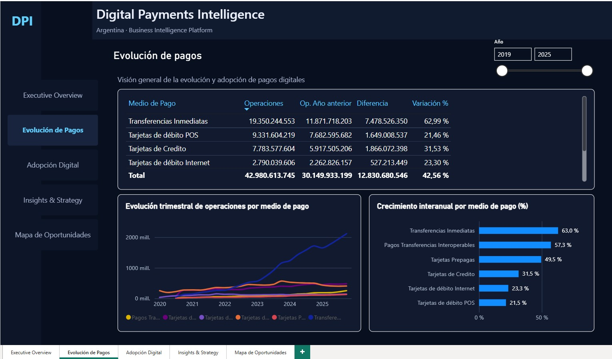
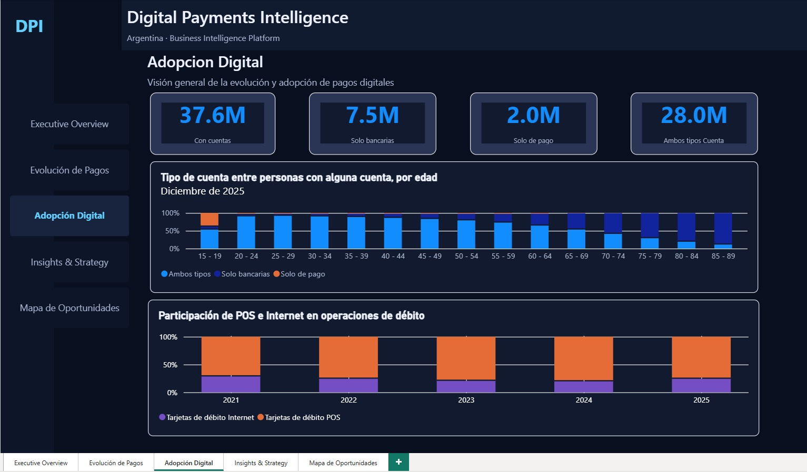
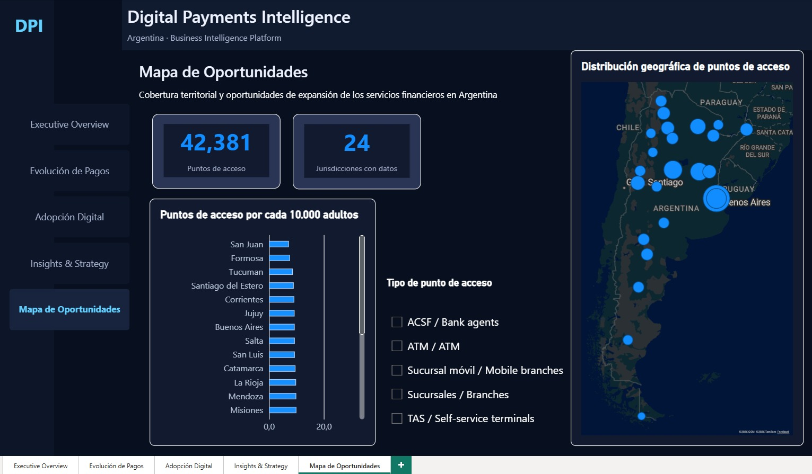
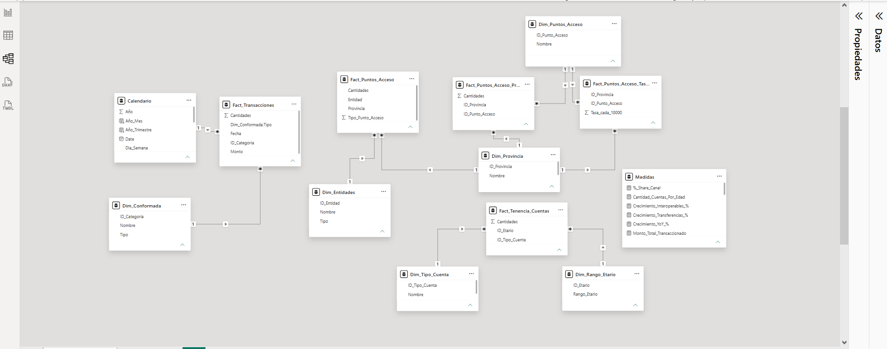
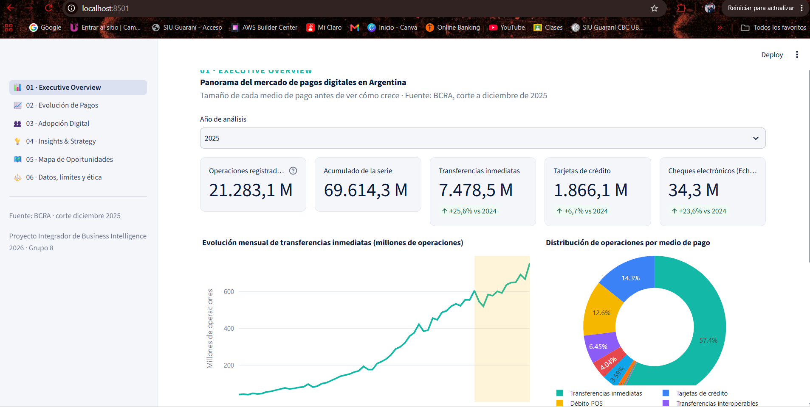

# 💳 Digital Payments Intelligence

**Dashboard de BI sobre pagos digitales e inclusión financiera en Argentina — Power BI + réplica en Python (Streamlit) con datos públicos del BCRA**

[](dashboard/TP_BI_Grupo8_final.pbix)
[](https://python.org)
[](https://streamlit.io)
[](https://plotly.com)
[](https://pandas.pydata.org)
[](data/README.md)

🔗 [LinkedIn](https://www.linkedin.com/in/emmanuel-ledesmam) · [GitHub](https://github.com/EmmaLedesma) · [Informe completo (PDF)](docs/Proyecto_Integrador_Grupo8.pdf)

---

## 📌 Concepto

Proyecto Integrador de materia **Business Intelligence - Universidad de la Ciudad de Buenos Aires** **2° Cuatrimestre 2026 (Grupo 8)**
Nos pusimos en el lugar del equipo de BI de una **fintech ficticia de pagos e inclusión financiera** para responder una sola pregunta:

> *"¿Dónde se concentran las mayores fricciones en los pagos digitales y las mayores brechas de infraestructura del país, para decidir qué producto desarrollar y hacia dónde expandirse?"*

El dashboard está pensado para tres perfiles que necesitan datos concretos para priorizar su hoja de ruta:

| Perfil | Qué decide con el dashboard |
|---|---|
| **Product Managers** | Qué funcionalidades priorizar según volumen y ritmo de crecimiento de cada medio de pago |
| **Marketing / Checkout** | Dónde está la fricción y qué segmentos (por edad) necesitan flujos distintos |
| **Expansión territorial** | Qué provincias diagnosticar primero según densidad de puntos de acceso |

Es un **diagnóstico descriptivo**: muestra qué pasó y cómo está la situación hoy. Las propuestas son **hipótesis de acción a validar con pilotos**, no recetas cerradas.

El repo tiene dos entregables que cuentan la misma historia:

1. **`dashboard/`** — el reporte original en **Power BI** (5 páginas + modelo estrella + medidas DAX).
2. **App en Python** — una réplica ejecutable (`streamlit run app.py`) construida sobre el mismo modelo de datos, **con tests que verifican que reproduce cada cifra del informe**.

---

## 📸 Capturas

| 01 · Executive Overview | 02 · Evolución de Pagos |
|---|---|
|  |  |
| **03 · Adopción Digital** | **05 · Mapa de Oportunidades** |
|  |  |

**Modelo de datos (esquema estrella)**




---

## 🔎 Hallazgos clave

| # | Hallazgo | Dato |
|---|---|---|
| 1 | Las **transferencias inmediatas** son el medio más usado | 7.478,5 M de operaciones en 2025 (≈ 4× las de tarjeta de crédito) |
| 2 | Los **pagos interoperables (QR)** son los que más rápido crecen | +40,7 % interanual (841,2 M) |
| 3 | El **débito físico (POS) retrocede** mientras el débito online sube | POS −19,4 % · Internet +5,4 % (de 19,6 % a 24,2 % del débito) |
| 4 | La mayoría combina **cuenta bancaria + billetera** | 74,6 % con ambas (28,03 M de personas, de 37,57 M) |
| 5 | **Brecha generacional** en la tenencia dual | 90,4 % entre 20-24 años vs 41,1 % entre 70-74 (−49,3 pp) |
| 6 | **Infraestructura muy dispar** entre provincias | San Juan 7,26 · Formosa 7,70 · Tucumán 8,70 puntos cada 10.000 adultos |
| 7 | **Mirar solo el total engaña** | Buenos Aires tiene 26× más puntos que La Pampa, pero La Pampa ofrece casi el doble de cobertura por adulto (16,24 vs 9,36) |

**Provincias prioritarias para diagnóstico de campo:** San Juan, Formosa y Tucumán.

---

## 🏗️ Arquitectura

```
┌──────────────────────────────────────────────────────────┐
│                  BCRA — datos públicos                   │
│  Pagos minoristas · Puntos de acceso · Tenencia de       │
│  cuentas por grupo etario (corte dic-2025)               │
└───────────────────────────┬──────────────────────────────┘
                            │ Power Query (limpieza, tipos, claves)
                            ▼
┌──────────────────────────────────────────────────────────┐
│              Power BI · modelo estrella                  │
│   5 tablas de hechos + dimensiones + medidas DAX         │
│   dashboard/TP_BI_Grupo8_final.pbix  (5 páginas)         │
└───────────────────────────┬──────────────────────────────┘
                            │ scripts/export_pbix_data.py
                            ▼
┌──────────────────────────────────────────────────────────┐
│         data/processed/*.csv  +  queries/*.dax           │
│        (el modelo versionado y legible en texto)         │
└───────────────────────────┬──────────────────────────────┘
                            │ src/payments_bi/data.py (pandas)
                            ▼
┌──────────────────────────────────────────────────────────┐
│  Métricas equivalentes a las medidas DAX  ◄── pytest     │
│  (23 tests: cada cifra del informe se verifica)          │
└───────────────────────────┬──────────────────────────────┘
                            │ Plotly + Streamlit
                            ▼
┌──────────────────────────────────────────────────────────┐
│       App web interactiva · 6 páginas (streamlit run)    │
└──────────────────────────────────────────────────────────┘
```

---

## ✅ Features

- **Dashboard Power BI** con 5 páginas: Executive Overview, Evolución de Pagos, Adopción Digital, Insights & Strategy y Mapa de Oportunidades
- **Modelo estrella** con relaciones muchos-a-uno y medidas DAX (YoY, participación, tenencia dual, densidad por 10.000 adultos)
- **Réplica en Python** de las páginas del dashboard, con filtros interactivos (año, medios de pago, tipo de punto de acceso)
- **Datos versionados en texto**: el modelo del `.pbix` exportado a CSV y las medidas DAX a `.dax`, para que se pueda revisar en un PR
- **Tests que protegen el análisis**: 23 tests verifican que cada cifra publicada (totales, variaciones, tenencia, densidades) se reproduce desde los datos
- **Página de límites y ética**: qué no se puede afirmar, sesgos conocidos y principios de gobernanza
- **CI** con GitHub Actions: los tests corren en cada push y pull request

---

## 🛠️ Stack Técnico

| Capa | Tecnología |
|------|-----------|
| BI / Dashboard | Power BI Desktop |
| ETL | Power Query (M) |
| Modelado | Esquema estrella + DAX |
| Procesamiento | Python 3.12 + pandas |
| Visualización | Plotly |
| App web | Streamlit (navegación multipágina) |
| Calidad | pytest + `streamlit.testing` (smoke test por página) |
| CI | GitHub Actions |
| Fuente de datos | BCRA (pagos minoristas, puntos de acceso, tenencia de cuentas) |

---

## 📁 Estructura del Proyecto

```
digital-payments-intelligence-bi/
├── .github/workflows/
│   └── ci.yml                       # pytest en cada push / PR
├── .streamlit/config.toml           # tema de la app
├── dashboard/
│   └── TP_BI_Grupo8_final.pbix      # reporte original de Power BI
├── data/
│   ├── README.md                    # fuentes BCRA y diccionario
│   └── processed/                   # modelo estrella en CSV
├── docs/
│   ├── Proyecto_Integrador_Grupo8.pdf   # informe completo
│   ├── data-model.md                # modelo de datos + notas de lectura
│   └── screenshots/                 # capturas para este README
├── queries/
│   ├── measures.dax                 # todas las medidas DAX del reporte
│   └── calendario.dax               # tabla Calendario
├── scripts/
│   └── export_pbix_data.py          # .pbix → CSV + DAX
├── src/payments_bi/
│   ├── data.py                      # carga + métricas (equivalentes a DAX)
│   ├── charts.py                    # gráficos Plotly
│   └── theme.py                     # paleta, formato es-AR, componentes UI
├── tests/
│   ├── test_metrics.py              # las cifras del informe, verificadas
│   └── test_app_smoke.py            # cada página corre sin errores
├── views/                           # una página por pestaña del dashboard
│   ├── overview.py · evolucion.py · adopcion.py
│   └── insights.py · mapa.py · limites.py
├── app.py                           # entrada de Streamlit
├── requirements.txt
└── requirements-dev.txt
```

---

## ⚡ Quick Start

### Requisitos
- Python 3.10+ (probado en 3.12)
- Git
- *(Opcional)* Power BI Desktop (Windows) para abrir el `.pbix`

### 1. Clonar el repo
```bash
git clone https://github.com/EmmaLedesma/digital-payments-intelligence-bi
cd digital-payments-intelligence-bi
```

### 2. Entorno virtual e instalación
```bash
# Windows (PowerShell)
python -m venv .venv
.venv\Scripts\Activate.ps1

# macOS / Linux
python3 -m venv .venv
source .venv/bin/activate

pip install -r requirements-dev.txt
```

### 3. Ejecutar la app
```bash
streamlit run app.py
```
Se abre en `http://localhost:8501`.

### 4. Correr los tests
```bash
pytest
```

### 5. *(Opcional)* Regenerar los datos desde el `.pbix`
```bash
python scripts/export_pbix_data.py dashboard/TP_BI_Grupo8_final.pbix
```

### Deploy gratuito
En [share.streamlit.io](https://share.streamlit.io) → **New app** → elegí el repo, la rama `main` y el archivo `app.py`.


## 🧗 Decisiones Técnicas

**¿Por qué una réplica en Python si el entregable era Power BI?**
Un `.pbix` es un binario que no se puede previsualizar en GitHub ni revisar en un pull request. Exportar el modelo a CSV/DAX y reconstruir las páginas en código vuelve el análisis **ejecutable, auditable y versionable**, y demuestra que se entiende la lógica detrás de las medidas y no solo cómo se arrastra un campo.

**¿Por qué tests sobre cifras de negocio?**
Cada número que aparece en el informe (7.478,5 M, +40,7 %, 74,6 %, 7,26 por 10.000…) tiene un test. Si alguien cambia los datos o una métrica, el CI avisa qué cifra dejó de coincidir.

**¿Por qué esquema estrella?**
Separa hechos (operaciones, puntos, personas) de dimensiones (categoría, provincia, edad, tipo de cuenta). Las medidas se vuelven simples y reutilizables, y los filtros cruzados se comportan de forma predecible.

**¿Por qué densidad por 10.000 adultos y no totales?**
Comparar provincias por cantidad bruta premia a las más grandes. La densidad pone en la misma escala a Buenos Aires y a La Pampa, y evita decisiones de expansión sesgadas hacia los grandes centros urbanos.

**¿Por qué coordenadas fijas en el mapa?**
El `.pbix` geocodifica con Azure Maps. En la app usamos centroides aproximados por provincia para no depender de un servicio externo ni de una API key.

---

## ⚖️ Límites y ética

Resumen (detalle en la página 06 de la app y en el [informe](docs/Proyecto_Integrador_Grupo8.pdf)):

- **No hay cruce entre personas y transacciones:** los datos no permiten saber la edad ni la provincia de quien paga.
- **Poca infraestructura ≠ poca adopción:** la densidad de puntos no mide demanda digital ni conectividad.
- **Canales superpuestos:** las transferencias inmediatas figuran también como canal *Push*; el total de operaciones registradas **no** mide el tamaño real del mercado.
- **Economía informal subrepresentada:** la infraestructura refleja solo lo formal.
- **Análisis descriptivo:** no predice ni garantiza retornos; las propuestas son hipótesis a validar con pilotos.

---

## 🔮 Mejoras Futuras

- 📅 Incorporar el próximo corte trimestral del BCRA y automatizar la descarga
- 🌡️ Sumar conectividad y bancarización previa por provincia para completar el diagnóstico territorial
- 🧪 Diseñar y medir un piloto de transferencias / cobro interoperable
- 🗺️ Reemplazar los centroides por polígonos provinciales (choropleth)
- ☁️ Deploy público de la app en Streamlit Community Cloud
- 🔄 Pipeline de actualización de datos con GitHub Actions

---

## 👥 Equipo

**Grupo 8 — Proyecto Integrador de Business Intelligence 2026** · Docentes: [Hernán Blejer](https://www.linkedin.com/in/hblejer/) y [Camila Vergez](https://www.linkedin.com/in/camilavergez/)

| Integrante | Rol |
|---|---|
| [Emmanuel Ledesma](https://www.linkedin.com/in/emmanuel-ledesmam) | Data Engineer |
| [Ignacio Leonetti](https://www.linkedin.com/in/ignacio-leonetti/) | Data Engineer |
| [Francisco Possamai](https://www.linkedin.com/in/franpossa1/) | BI Developer |
| [Jordi Galmán](https://www.linkedin.com/in/jordigalman/) | BI Developer |
| [Ileana Marcano](https://www.linkedin.com/in/ileanamarcanogonzalez/) | UX BI Developer |
| [Carolina Alfonso](https://www.linkedin.com/in/caroalfonso/) | Data Analyst & Storyteller |

---

## 💼 Este Proyecto Demuestra

**Business Intelligence**
- Modelado dimensional (esquema estrella), medidas DAX, diseño de dashboards para audiencias distintas

**Data Engineering**
- Limpieza y carga con Power Query, exportación del modelo a formatos abiertos, ingestión reproducible desde un script

**Python para datos**
- pandas + Plotly + Streamlit, métricas equivalentes a DAX, app multipágina

**Calidad y rigor analítico**
- Tests sobre cifras de negocio, integridad referencial, CI con GitHub Actions, explicitación de límites y sesgos

**Storytelling con datos**
- Del dato descriptivo a la hipótesis accionable, con dos narrativas distintas para los mismos datos

---

## 📝 Licencia

Código bajo licencia MIT. Los datos son públicos y pertenecen al Banco Central de la República Argentina (BCRA). Proyecto orientado al aprendizaje y desarrollo de portfolio profesional.

*Code made by Emmanuel Ledesma*
🔗 [linkedin.com/in/emmanuel-ledesmam](https://www.linkedin.com/in/emmanuel-ledesmam)

---

# English Version

# 💳 Digital Payments Intelligence

**BI dashboard on digital payments and financial inclusion in Argentina — Power BI + Python (Streamlit) replica, built on public data from the Central Bank (BCRA)**

🔗 [LinkedIn](https://www.linkedin.com/in/emmanuel-ledesmam) · [GitHub](https://github.com/EmmaLedesma)

---

## 📌 Concept

Capstone project for **Business Intelligence 2026 (Team 8)-Universidad de la Ciudad de Buenos Aires**. We played the role of the BI team at a fictional payments and financial-inclusion fintech and asked one question:

> *"Where are the biggest frictions in digital payments and the biggest infrastructure gaps in the country, so we can decide what to build and where to expand?"*

It is a **descriptive diagnostic** for Product Managers, UX/Checkout designers and territorial-expansion leads. Recommendations are **hypotheses to test with pilots**, not closed prescriptions.

The repo ships two deliverables that tell the same story:

1. **`dashboard/`** — the original **Power BI** report (5 pages, star schema, DAX measures).
2. **A runnable Python app** (`streamlit run app.py`) on top of the same data model, with **tests that verify it reproduces every figure in the report**.

## 🔎 Key Findings

- **Instant transfers** are the most-used payment method: 7,478.5 M operations in 2025 (≈ 4× credit cards)
- **Interoperable (QR) payments** grow fastest: +40.7% YoY
- **In-store debit (POS) declines** (−19.4%) while **online debit grows** (+5.4%; 19.6% → 24.2% of debit)
- **74.6%** of account holders have both a bank and a payment account; dual holding is **90.4%** at ages 20–24 vs **41.1%** at 70–74
- **Uneven infrastructure**: San Juan (7.26), Formosa (7.70) and Tucumán (8.70) access points per 10,000 adults are the priority provinces for field diagnosis
- **Totals can mislead**: Buenos Aires has 26× more access points than La Pampa, but La Pampa offers almost twice the coverage per adult

## ⚡ Quick Start

```bash
git clone https://github.com/EmmaLedesma/digital-payments-intelligence-bi
cd digital-payments-intelligence-bi
python -m venv .venv && source .venv/bin/activate   # Windows: .venv\Scripts\Activate.ps1
pip install -r requirements-dev.txt
streamlit run app.py
pytest
```

## 💼 This Project Demonstrates

**Business Intelligence** — dimensional modeling, DAX, audience-aware dashboards
**Data Engineering** — Power Query, open-format model export, reproducible ingestion
**Python for data** — pandas + Plotly + Streamlit, DAX-equivalent metrics
**Analytical rigor** — business-figure tests, CI, explicit limits and biases

---

*Code made by Emmanuel Ledesma*
🔗 [linkedin.com/in/emmanuel-ledesmam](https://www.linkedin.com/in/emmanuel-ledesmam)
