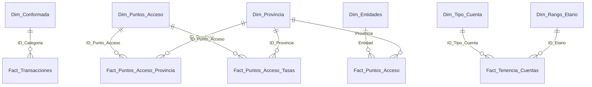

# Modelo de datos

Esquema **estrella** construido en Power BI (Power Query + DAX). Las relaciones son todas *muchos a uno* con filtro en un solo sentido.



## Tablas de hechos

| Tabla | Granularidad | Medidas | Filas |
|---|---|---|---|
| `Fact_Transacciones` | categoría × mes | `Cantidades` (operaciones), `Monto` | 1.052 |
| `Fact_Puntos_Acceso_Provincia` | provincia × tipo de punto | `Cantidades` | 106 |
| `Fact_Puntos_Acceso_Tasas` | provincia × tipo de punto | `Tasa_cada_10000` | 106 |
| `Fact_Tenencia_Cuentas` | rango etario × tipo de cuenta | `Cantidades` (personas) | 90 |
| `Fact_Puntos_Acceso` | entidad × provincia × tipo | `Cantidades` | 1.359 |

## Dimensiones

| Tabla | Contenido |
|---|---|
| `Dim_Conformada` | 16 categorías de operación (medios de pago, canales *Push*, extracciones) |
| `Dim_Provincia` | 24 jurisdicciones |
| `Dim_Puntos_Acceso` | ACSF (agentes), ATM, sucursales, sucursales móviles, TAS (autoservicio) |
| `Dim_Rango_Etario` | 15 rangos de 5 años (15-19 … 85-89) |
| `Dim_Tipo_Cuenta` | solo bancaria, solo de pago, ambas, y totales (al menos una cuenta) |
| `Dim_Entidades` | 80 entidades financieras |
| `Calendario` | tabla calculada en DAX (`queries/calendario.dax`) |

## Cosas que conviene saber al leer los datos

- **Canales *Push*** (`ID_Categoria` 9 y 10): coinciden en volumen anual con las transferencias inmediatas (`ID_Categoria` 3) entre 2021 y 2025; es decir, describen las **mismas operaciones** vistas por canal. Por eso el total "de todas las categorías" (21.283,1 M en 2025) tiene solapamiento y no mide el tamaño real del mercado.
- La serie de **medios de pago** empieza en septiembre de 2020; la de transferencias *Push* arranca en 2017. Por eso el "acumulado de la serie" (69.614,3 M) cubre 2017-2025.
- **Densidad territorial** (`Puntos_Cada_10000_Adultos`): suma de las tasas de los 5 tipos de punto de acceso por provincia.
- La tenencia de cuentas es una foto al **1/12/2025**: no hay serie histórica.

## Medidas DAX clave

Todas las medidas están en [`queries/measures.dax`](../queries/measures.dax). Algunas:

```dax
Total_Transacciones = SUM(Fact_Transacciones[Cantidades])

Participacion_Debito_Internet_% =
VAR Internet    = CALCULATE([Total_Transacciones], Dim_Conformada[ID_Categoria] = 16)
VAR DebitoTotal = CALCULATE([Total_Transacciones], Dim_Conformada[ID_Categoria] IN {15, 16})
RETURN DIVIDE(Internet, DebitoTotal)

Personas_Ambas_Cuentas_% =
DIVIDE([Personas_Ambos_Tipos_Cuenta], [Personas_Con_Alguna_Cuenta])
```

Cada una tiene su equivalente en Python en [`src/payments_bi/data.py`](../src/payments_bi/data.py) y está verificada por [`tests/test_metrics.py`](../tests/test_metrics.py).
